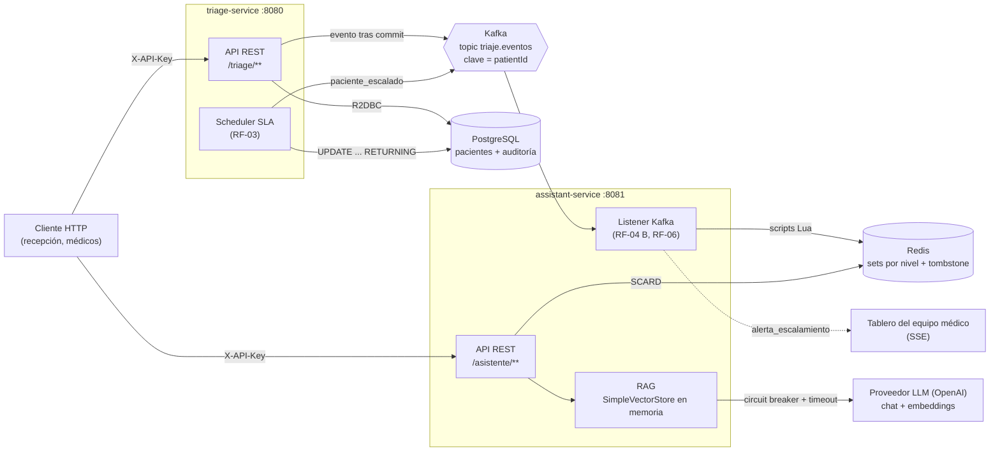

# VidaCruz – Sistema de triaje digital con asistente clínico

Backend reactivo (Spring WebFlux + Project Reactor) con dos microservicios que solo se comunican por Kafka:

- **`triage-service`** registra pacientes con sus signos vitales, los clasifica en 5 niveles según reglas clínicas objetivas (RN-01), gestiona su flujo de estados, escala de forma automática a quienes superan su SLA, deja una auditoría clínica de solo inserción y genera un reporte operativo por hora calculado 100 % en SQL.
- **`assistant-service`** responde preguntas sobre los protocolos clínicos internos con RAG. Siempre cita la fuente y nunca inventa contenido: si no hay protocolo relevante, lo dice sin llamar al LLM. Además mantiene en Redis el estado de la urgencia en tiempo real a partir de los eventos de Kafka y alerta los escalamientos por Server-Sent Events.

Enunciado: [`docs/challenge.txt`](docs/challenge.txt). Decisiones: [`docs/adr/`](docs/adr/) y [`docs/assumptions.md`](docs/assumptions.md) (41 supuestos numerados; en este README, "supuesto N" se refiere a esa tabla).

## Alcance entregado

✅ implementado · ⚠️ parcial · ❌ no realizado

### Requerimientos funcionales y reglas de negocio

| Requisito | Estado | Dónde |
|---|---|---|
| RF-01 Registro, validaciones (400 con el campo) y clasificación RN-01 | ✅ | [`RegisterPatient`](triage-service/src/main/java/com/vidacruz/triage/application/RegisterPatient.java), [`TriageClassifier`](triage-service/src/main/java/com/vidacruz/triage/domain/TriageClassifier.java), supuestos 6–10 |
| RF-02 Flujo de estados (404 / 400 / 409), GET con flag `escalado` y tiempo en estado | ✅ | [`ChangePatientStatus`](triage-service/src/main/java/com/vidacruz/triage/application/ChangePatientStatus.java), supuestos 13–16 |
| RF-03 Escalamiento por SLA, idempotente (RN-03), configurable | ✅ | [`EscalateOverduePatients`](triage-service/src/main/java/com/vidacruz/triage/application/EscalateOverduePatients.java), supuestos 17–19 |
| RF-04 A Consulta con RAG, citas y "sin protocolo" (RN-05) | ✅ | [`AnswerClinicalQuestion`](assistant-service/src/main/java/com/vidacruz/assistant/application/AnswerClinicalQuestion.java), [ADR-003](docs/adr/ADR-003-rag-y-modo-degradado.md) |
| RF-04 B Estado de la urgencia desde Kafka en Redis | ✅ | [`ApplyPatientEvent`](assistant-service/src/main/java/com/vidacruz/assistant/application/ApplyPatientEvent.java), [ADR-002](docs/adr/ADR-002-integracion-kafka.md) |
| RF-05 Reporte por hora con SQL avanzado | ✅ | [`GetOperationReport`](triage-service/src/main/java/com/vidacruz/triage/application/GetOperationReport.java), supuestos 4, 20–22 |
| RF-06 Alertas de escalamiento (SSE) | ✅ | [`NotifyEscalation`](assistant-service/src/main/java/com/vidacruz/assistant/application/NotifyEscalation.java), [ADR-004](docs/adr/ADR-004-alertas-escalamiento.md) |
| RN-04 Auditoría no borrable (sin DELETE, trigger que bloquea UPDATE/DELETE) | ✅ | [migraciones](triage-service/src/main/resources/db/migration/) |

### Requerimientos técnicos

| Requisito | Estado | Dónde / nota |
|---|---|---|
| 2 microservicios, comunicación solo por Kafka | ✅ | [ADR-001](docs/adr/ADR-001-descomposicion-servicios.md) |
| WebFlux + R2DBC, sin bloqueos en el event loop | ✅ | Spring AI en `boundedElastic`; Flyway usa JDBC solo al arrancar, antes del servidor |
| Kafka `triaje.eventos` con los 4 eventos, formato documentado | ✅ | [ADR-002](docs/adr/ADR-002-integracion-kafka.md) |
| Publicación sin pérdida (patrón Outbox) | ❌ | Publicación best effort después del commit; limitación documentada (supuesto 12) |
| Resilience4j: circuit breaker + 503 | ✅ | [ADR-003](docs/adr/ADR-003-rag-y-modo-degradado.md) |
| RAG con vector store documentado en ADR | ✅ | `SimpleVectorStore` en memoria, [ADR-003](docs/adr/ADR-003-rag-y-modo-degradado.md) |
| Health / readiness, logs estructurados con correlación | ✅ | Supuestos 34–36 |
| Métricas: clasificaciones por nivel, escalamientos, latencia del LLM | ✅ | Supuesto 37 |
| Trazado distribuido con OpenTelemetry (bonus) | ⚠️ | Micrometer Tracing con el bridge de OTel y propagación W3C por HTTP y Kafka; **sin exportador**: las trazas solo se ven como `traceId` en los logs (supuesto 36) |
| Seguridad: sin credenciales en el código, API key, validación de entradas | ✅ | Supuestos 2 y 33 |
| Tests unitarios + integración, LLM mockeable | ✅ | [Tests](#tests) |
| docker-compose con un solo comando | ✅ | [`docker-compose.yml`](docker-compose.yml) |
| Manifests de Kubernetes con Azure como objetivo (AKS) | ✅ | [`k8s/`](k8s/), validados con `kubectl kustomize` + kubeconform, **no aplicados a un clúster** |
| ADR (mínimo 2) | ✅ | 4 ADR en [`docs/adr/`](docs/adr/) |

### Entregables

| Entregable | Estado | Nota |
|---|---|---|
| 1. Repositorio con el código fuente | ✅ | Historial de commits progresivo |
| 2. README | ✅ | Este archivo |
| 3. Tests automatizados de los flujos de negocio | ✅ | [Tests](#tests) |
| 4. URL desplegada en Azure + manifests | ⚠️ | **No se desplegó en Azure por falta de tiempo.** Se entregan los manifests en [`k8s/`](k8s/) y los pasos completos (ACR, Secret, servicios gestionados, verificación) en [`k8s/README.md`](k8s/README.md). |
| 5. ADR (mínimo 2) | ✅ | [ADR-001](docs/adr/ADR-001-descomposicion-servicios.md) a [ADR-004](docs/adr/ADR-004-alertas-escalamiento.md) |

## Cómo ejecutarlo

**Requisitos:** Docker con Docker Compose. Java 21 solo hace falta para correr los tests (el build de las imágenes compila dentro de Docker).

1. Crear el `.env` a partir del ejemplo:
   ```bash
   cp .env.example .env
   ```
2. Inventar los valores de las tres variables obligatorias (sin ellas, compose no arranca):

   | Variable | Qué poner |
   |---|---|
   | `POSTGRES_PASSWORD` | Cualquier contraseña. |
   | `TRIAGE_API_KEY` | Una clave larga, por ejemplo `openssl rand -hex 32`. Es el `X-API-Key` de Triage. |
   | `ASSISTANT_API_KEY` | Otra clave distinta. Es el `X-API-Key` del Asistente. |
   | `OPENAI_API_KEY` | **Opcional.** Sin ella todo funciona salvo `POST /asistente/consulta`, que responde **503**: es el modo degradado que pide el enunciado. Para usarla, descomentar la línea y poner la clave. No dejarla vacía (`OPENAI_API_KEY=`), ver supuesto 1. |

   El formato es `KEY=VALUE`, sin comillas.
3. Levantar todo (PostgreSQL, Kafka, Redis y los dos servicios):
   ```bash
   docker compose up --build
   ```
   Triage queda en `http://localhost:8080` y el Asistente en `http://localhost:8081`. Los 5 contenedores llegan a `healthy` en aproximadamente un minuto.

### Probarlo

**IntelliJ HTTP Client.** [`http/triage.http`](http/triage.http) y [`http/assistant.http`](http/assistant.http) tienen ejemplos de todos los endpoints, con la respuesta esperada en cada uno (E1–E6, transiciones válidas e inválidas, reporte, las 3 consultas del enunciado, SSE). Seleccionar el entorno `local` y poner las claves en `http/http-client.private.env.json` (ignorado por git):

```json
{ "local": { "triageApiKey": "<TRIAGE_API_KEY>", "assistantApiKey": "<ASSISTANT_API_KEY>" } }
```

**curl** (con las claves del `.env` exportadas en la shell):

```bash
# Registrar el paciente E1 → 201, nivel CRITICO, slaMinutos 5
curl -i -X POST http://localhost:8080/triage/pacientes \
  -H "X-API-Key: $TRIAGE_API_KEY" -H "Content-Type: application/json" \
  -d '{"nombreCompleto":"Ana Pérez","edad":45,"frecuenciaCardiaca":130,"presionSistolica":180,
       "presionDiastolica":110,"spo2":97,"temperatura":36.8,"dolor":8,"gcs":15,"quejaPrincipal":"Dolor torácico"}'

# Ver el estado de la urgencia, reconstruido desde Kafka
curl -s http://localhost:8081/asistente/estado-urgencias -H "X-API-Key: $ASSISTANT_API_KEY"
# {"totalActivos":1,"porNivel":{"CRITICO":1,"URGENTE":0,"URGENTE_2":0,"NO_URGENTE":0,"NO_URGENTE_2":0}}

# Escuchar las alertas de escalamiento (SSE); con el SLA de 5 min, E1 se escala a los ~5 min
curl -N http://localhost:8081/asistente/alertas/stream -H "X-API-Key: $ASSISTANT_API_KEY"
```

Para probar el escalamiento sin esperar, los SLA y el intervalo del scheduler se configuran en `application.yml` (`triage.sla.*`, `triage.escalation.interval`, variable `TRIAGE_ESCALATION_INTERVAL`).

## Arquitectura



Triage nunca llama al Asistente: si el Asistente, Redis o el LLM están caídos, el registro clínico sigue funcionando. El Asistente nunca llama a la API ni a la base de Triage ([ADR-001](docs/adr/ADR-001-descomposicion-servicios.md)).

**Organización hexagonal en cada servicio** (`com.vidacruz.<servicio>`):

- `domain`: modelo y reglas puras, sin Spring (clasificación RN-01, transiciones de estado, regla de vencimiento del SLA).
- `application`: casos de uso y puertos (`PatientEventPublisher`, `AuditRepository`, `AlertNotifier`…).
- `infrastructure`: adaptadores (WebFlux, R2DBC, Kafka, Redis, Spring AI, scheduler, seguridad, métricas). El dominio y la base usan valores en inglés (`CRITICAL`, `REGISTERED`); un mapper los traduce a los valores del contrato en español (`CRITICO`, `REGISTRADO`) solo en la API y en los eventos (supuesto 3).

No hay código compartido entre los servicios: el contrato es el JSON del evento.

## Endpoints

Todos exigen el header `X-API-Key` salvo `/actuator/health/**`. Los errores son `ProblemDetail` (`application/problem+json`) en español; los 400 incluyen `errors: [{campo, mensaje}]`.

| Método | Ruta | Descripción | Códigos |
|---|---|---|---|
| `POST` | `/triage/pacientes` | RF-01: registra y clasifica. Devuelve `id`, `nivel`, `slaMinutos`, `estado`, `fechaRegistro` y `Location`. | 201, 400, 401 |
| `GET` | `/triage/pacientes/{id}` | RF-02: datos completos, `estado`, `escalado`, `fechaEscalamiento`, `tiempoEnEstadoActual` (ISO 8601, `PT12M30S`). | 200, 400 (id no UUID), 401, 404 |
| `PATCH` | `/triage/pacientes/{id}/estado` | RF-02: cuerpo `{"estado": "EN_CONSULTA" \| "ALTA"}`. | 200, 400, 401, 404, 409 (transición inválida o modificación concurrente) |
| `GET` | `/triage/reportes/operacion?desde&hasta[&zonaHoraria]` | RF-05: por hora, `totalRegistrados`, `conteoPorNivel`, `pacientesAtendidos`, `esperaPromedioMinutos`, `esperaP95Minutos`. Rango `[desde, hasta)` de hasta 31 días, ISO 8601 con zona. | 200, 400, 401 |
| `POST` | `/asistente/consulta` | RF-04 A: cuerpo `{"pregunta": "..."}` (máx. 1000 caracteres). Devuelve `respuesta` y `fuentes[{protocolo, seccion}]`. | 200, 400, 401, 503 (LLM no disponible o índice cargando) |
| `GET` | `/asistente/estado-urgencias` | RF-04 B: `totalActivos` y `porNivel` (los 5 niveles, `EN_CONSULTA` cuenta como activo). | 200, 401, 503 (Redis no disponible) |
| `GET` | `/asistente/alertas/stream` | RF-06: `text/event-stream` con eventos `alerta_escalamiento` y heartbeat cada 15 s. | 200, 401 |
| `GET` | `/actuator/health`, `/actuator/health/liveness`, `/actuator/health/readiness` | Probes, públicos. | 200, 503 |
| `GET` | `/actuator/prometheus` | Métricas, protegido con `X-API-Key`. | 200, 401 |

## Eventos

Topic `triaje.eventos` (3 particiones), clave = `patientId`, JSON como texto. Las claves van en inglés y los valores siguen el contrato en español ([ADR-002](docs/adr/ADR-002-integracion-kafka.md)).

| `eventType` | Cuándo se publica | `status` |
|---|---|---|
| `paciente_registrado` | Registro (RF-01) | `REGISTRADO` |
| `paciente_en_consulta` | `REGISTRADO → EN_CONSULTA` (RF-02) | `EN_CONSULTA` |
| `paciente_alta` | `REGISTRADO → ALTA` o `EN_CONSULTA → ALTA` (RF-02) | `ALTA` |
| `paciente_escalado` | El scheduler escala al paciente, una sola vez (RF-03, RN-03) | `REGISTRADO` |

```json
{
  "eventId": "6f1c2a0e-9a4b-4b8e-9f43-2d7c1e0b5a11",
  "eventType": "paciente_registrado",
  "occurredAt": "2026-11-13T10:00:00.123456Z",
  "patientId": "3f1a8c2d-4e5b-4c6d-8e7f-9a0b1c2d3e4f",
  "level": "CRITICO",
  "status": "REGISTRADO"
}
```

Cada evento lleva además el header `traceparent` (W3C) con el `traceId` de la petición que lo originó.

## Tecnologías

| Tecnología | Versión | Uso |
|---|---|---|
| Java | 21 | |
| Spring Boot | 3.5.16 | El enunciado exige Spring Boot 3, y 3.5.16 es la última versión 3.x. |
| Spring WebFlux + Project Reactor | (Boot) | API reactiva con `Mono` / `Flux`. |
| Spring Data R2DBC + `r2dbc-postgresql` | (Boot) | Acceso reactivo a PostgreSQL (`DatabaseClient` con SQL explícito). |
| Flyway | (Boot) | Migraciones. Usa JDBC solo al arrancar, antes de abrir el servidor. |
| Spring Kafka | (Boot) | Productor y listeners que devuelven `Mono`. **No** Reactor Kafka, descontinuado ([ADR-002](docs/adr/ADR-002-integracion-kafka.md)). |
| Spring Data Redis reactivo (Lettuce) | (Boot) | Vista del Asistente con `ReactiveRedisTemplate` y scripts Lua. |
| Spring AI | 1.1.8 | RAG con `SimpleVectorStore` y OpenAI. Se eligió la línea 1.1.x por ser la compatible con Boot 3. |
| Resilience4j | 2.4.0 | Circuit breaker + time limiter con el operador de Reactor. |
| Micrometer + Actuator | (Boot) | Probes, métricas Prometheus, Micrometer Tracing con bridge de OpenTelemetry. |
| PostgreSQL / Kafka (KRaft) / Redis | 16 / 3.9.1 / 7 | Imágenes de docker-compose. |
| OpenAI | `gpt-4o-mini`, `text-embedding-3-small` | Configurables con `OPENAI_CHAT_MODEL` y `OPENAI_EMBEDDING_MODEL`. |
| JUnit 5, StepVerifier, WebTestClient, Testcontainers, Awaitility | (Boot) | Tests. |

> **Nota sobre versiones.** La rama 3.5 de Spring Boot terminó su soporte OSS en junio de 2026. Se mantuvo porque el enunciado pide Spring Boot 3; en un proyecto real se migraría a Spring Boot 4 y Spring AI 2.x.

## Decisiones clave

1. **Dos microservicios que solo se comunican por Kafka**, hexagonales y sin código compartido; RF-06 vive en el Asistente detrás de un puerto, extraíble a un tercer servicio. → [ADR-001](docs/adr/ADR-001-descomposicion-servicios.md)
2. **Vista del Asistente conmutativa e idempotente.** Los listeners async de Spring Kafka no garantizan el orden de aplicación, así que la vista usa sets por nivel y un tombstone de altas con scripts Lua: el resultado es el mismo en cualquier orden y con repeticiones. → [ADR-002](docs/adr/ADR-002-integracion-kafka.md), supuestos 24–25
3. **Publicación después del commit, detrás de `PatientEventPublisher`.** Un Kafka caído no impide registrar; el evento puede perderse (limitación del nivel 1), y el Outbox reemplazaría solo el adaptador. → [ADR-002](docs/adr/ADR-002-integracion-kafka.md), supuesto 12
4. **RAG con doble barrera anti-alucinación**: umbral calibrado de 0,50 que evita llamar al LLM sin contexto, `SIN_PROTOCOLO` y fuentes construidas y validadas en Java. → [ADR-003](docs/adr/ADR-003-rag-y-modo-degradado.md)
5. **Modo degradado explícito**: circuit breaker + timeout con 503, índice no cargado → 503 (nunca "sin protocolo"), reintentos de Spring AI desactivados y readiness independiente del LLM. → [ADR-003](docs/adr/ADR-003-rag-y-modo-degradado.md)
6. **Escalamiento con un único `UPDATE ... WHERE status='REGISTERED' AND escalated=false RETURNING`**, sin locks distribuidos: seguro con varias réplicas y frente a un PATCH concurrente. "Superó el SLA" es estricto y el SLA se fija al registrar. → supuestos 17–19
7. **RF-05 en una sola consulta SQL** (`generate_series`, `date_trunc` con zona, `ROW_NUMBER() OVER`, `COUNT(*) FILTER`, `percentile_cont`), serie continua y rango semiabierto. → supuestos 4, 20–22
8. **Alertas por SSE** para un tablero en vivo, sin infraestructura nueva y con backpressure por cliente. → [ADR-004](docs/adr/ADR-004-alertas-escalamiento.md)

Todos los supuestos: [`docs/assumptions.md`](docs/assumptions.md).

## Evidencia del RAG con OpenAI real

**Calibración del umbral** (similitud coseno con `text-embedding-3-small`, medida con [`RagThresholdCalibrationTest`](assistant-service/src/test/java/com/vidacruz/assistant/infrastructure/rag/RagThresholdCalibrationTest.java)). En **negrita**, lo que se recupera con el umbral 0,50:

| Sección | Crisis hipertensiva | Sepsis | Diabetes tipo 2 |
|---|---|---|---|
| PROTO-001 · Medidas iniciales | **0,7406** | 0,3832 | 0,3814 |
| PROTO-001 · Contraindicaciones | **0,6910** | 0,3973 | 0,3901 |
| PROTO-001 · Definición | **0,6861** | 0,3507 | 0,3406 |
| PROTO-002 · Acciones iniciales | 0,4733 | **0,6003** | 0,3277 |
| PROTO-002 · Criterios | 0,4099 | 0,4553 | 0,2359 |
| PROTO-003 · Rehidratación | 0,3948 | 0,3416 | 0,2811 |
| PROTO-003 · Clasificación | 0,3620 | 0,2421 | 0,2630 |

Detalle del criterio y sus limitaciones en [`docs/assumptions.md`](docs/assumptions.md) ("Calibración del umbral del RAG").

**Respuestas reales** de `POST /asistente/consulta` con `gpt-4o-mini`, temperatura 0:

1. "¿Cuáles son las medidas iniciales ante una crisis hipertensiva?"
   ```json
   {
     "respuesta": "Reconfirmar la presión tras 5 minutos de reposo. No reducir la presión más de un 25% en la primera hora. Vigilar signos de encefalopatía.",
     "fuentes": [{ "protocolo": "PROTO-001", "seccion": "Medidas iniciales" }]
   }
   ```
2. "¿Cuándo se administra el primer antibiótico en sepsis?"
   ```json
   {
     "respuesta": "Antibiótico de amplio espectro en la primera hora.",
     "fuentes": [{ "protocolo": "PROTO-002", "seccion": "Acciones iniciales" }]
   }
   ```
3. "¿Cuál es el tratamiento de primera línea para la diabetes tipo 2?"
   ```json
   {
     "respuesta": "No existe un protocolo disponible en el corpus para esta pregunta.",
     "fuentes": []
   }
   ```

## Tests

```bash
./mvnw verify                      # todo (requiere Docker en marcha para Testcontainers)
./mvnw -pl triage-service verify   # un solo módulo
```

Los tests de integración levantan PostgreSQL, Kafka y Redis reales con Testcontainers. **El LLM se reemplaza por modelos falsos** (chat programable y embeddings deterministas), así que no hace falta clave de OpenAI. La calibración contra OpenAI real está desactivada por defecto y se ejecuta con `-Drag.calibration=true` y `OPENAI_API_KEY`.

Resultado del último `./mvnw verify`:

| Servicio | Tests | Qué cubren |
|---|---|---|
| `triage-service` | 249, 0 fallos | Clasificación y valores límite, validaciones, transiciones, escalamiento (unitario, con PostgreSQL real y en paralelo), reporte SQL, migraciones y trigger de auditoría, métricas, API key, propagación del traceId a Kafka. |
| `assistant-service` | 138, 0 fallos, 1 omitido (calibración) | RAG (citas, sin coincidencia, validación de fuentes, 503, índice no listo), corpus, consumidor y vista en Redis (permutaciones de orden), alertas SSE de punta a punta, API key, propagación del traceId. |

Mínimos del enunciado:

| Mínimo | Tests |
|---|---|
| Clasificación de E1–E6 | [`TriageClassifierTest`](triage-service/src/test/java/com/vidacruz/triage/domain/TriageClassifierTest.java) (más valores límite) y [`RegisterPatientApiTest`](triage-service/src/test/java/com/vidacruz/triage/infrastructure/web/RegisterPatientApiTest.java) (por la API, con PostgreSQL y Kafka) |
| Transiciones válidas e inválidas | [`PatientStatusTransitionTest`](triage-service/src/test/java/com/vidacruz/triage/domain/PatientStatusTransitionTest.java), [`ChangePatientStatusTest`](triage-service/src/test/java/com/vidacruz/triage/application/ChangePatientStatusTest.java), [`PatientStatusApiTest`](triage-service/src/test/java/com/vidacruz/triage/infrastructure/web/PatientStatusApiTest.java) |
| Idempotencia del escalamiento | [`PatientEscalationTest`](triage-service/src/test/java/com/vidacruz/triage/domain/PatientEscalationTest.java), [`EscalateOverduePatientsTest`](triage-service/src/test/java/com/vidacruz/triage/application/EscalateOverduePatientsTest.java), [`EscalationIntegrationTest`](triage-service/src/test/java/com/vidacruz/triage/infrastructure/scheduling/EscalationIntegrationTest.java) (dos escalamientos en paralelo: una auditoría, un evento) |
| Citas del RAG | [`AnswerClinicalQuestionTest`](assistant-service/src/test/java/com/vidacruz/assistant/application/AnswerClinicalQuestionTest.java), [`ClinicalQueryApiTest`](assistant-service/src/test/java/com/vidacruz/assistant/infrastructure/web/ClinicalQueryApiTest.java) (consultas 1 y 2 del enunciado) |
| Sin coincidencia, sin alucinación | Los mismos: consulta 3 sin llamar al chat, `SIN_PROTOCOLO`, fuentes inventadas o no recuperadas → aviso fijo con `fuentes: []` |
| LLM mockeable / modo degradado | [`ClinicalQueryApiTest`](assistant-service/src/test/java/com/vidacruz/assistant/infrastructure/web/ClinicalQueryApiTest.java) (503 con circuito abierto y timeout), [`KnowledgeBaseNotReadyTest`](assistant-service/src/test/java/com/vidacruz/assistant/infrastructure/web/KnowledgeBaseNotReadyTest.java) |

## Seguridad y observabilidad

**Seguridad**
- Ninguna credencial en el código: todo por variables de entorno; `.env` ignorado por git y `.env.example` versionado. La contraseña de PostgreSQL y las API keys no tienen valor por defecto (supuestos 2 y 39).
- Autenticación por header `X-API-Key`, una clave distinta por servicio, comparación en tiempo constante y 401 como `ProblemDetail`. Solo `/actuator/health/**` es público; `/actuator/prometheus` está protegido (supuesto 33).
- Validación estricta de entradas: rangos del enunciado, coerción de tipos desactivada, temperatura con un decimal como máximo, 400 que nombra cada campo inválido (supuestos 6–10).
- Imágenes con usuario no root; en Kubernetes, raíz de solo lectura y sin capabilities (supuestos 38 y 41).

**Observabilidad**
- Liveness sin dependencias; readiness de Triage = PostgreSQL y del Asistente = Redis. Ninguna depende de Kafka ni del LLM (supuesto 34).
- Logs JSON ECS por defecto (texto plano con el perfil `local`), con `traceId` y `spanId` en cada línea (supuesto 35).
- Correlación W3C por HTTP y Kafka: un registro y su procesamiento en el Asistente comparten `traceId` (supuesto 36).
- Métricas: `triage_classifications_total{level}`, `triage_escalations_total{level}` y `assistant_llm_latency_seconds{operation,outcome}`, además de las de Resilience4j y Spring AI (supuesto 37).

Detalle en [`docs/assumptions.md`](docs/assumptions.md).

## Limitaciones y qué haría con más tiempo

- **Despliegue en Azure.** No se realizó. Los manifests de AKS están en [`k8s/`](k8s/) y validados de forma local; faltan crear los servicios gestionados, aplicar y verificar contra un clúster real ([`k8s/README.md`](k8s/README.md)).
- **Patrón Outbox.** Hoy un fallo de Kafka después del commit pierde el evento (queda un `ERROR` en el log). Outbox en la misma transacción, detrás de `PatientEventPublisher` ([ADR-002](docs/adr/ADR-002-integracion-kafka.md)).
- **OpenTelemetry completo.** Agregar `opentelemetry-exporter-otlp` y un collector (por ejemplo Azure Monitor); el código ya propaga el contexto.
- **pgvector** para un corpus grande o varias réplicas del Asistente ([ADR-003](docs/adr/ADR-003-rag-y-modo-degradado.md)).
- **UID numérico fijo en la imagen**, para no depender de `runAsUser: 100` en Kubernetes (supuesto 41).
- **Cola de atención por nivel y SLA restante** (quién debe entrar a consulta primero), que hoy no expone ningún endpoint.
- **Campo `sede`** para las 12 salas de urgencias: el contrato actual no lo tiene, así que hay un solo tablero y un solo reporte.
- **JWT con Entra ID** (Spring Security resource server) en lugar de API keys estáticas (supuesto 33).
- **Alertas con varias réplicas del Asistente**: grupo de consumidores por instancia o fan-out por Redis Pub/Sub ([ADR-004](docs/adr/ADR-004-alertas-escalamiento.md)).
- **BlockHound** en los tests para detectar bloqueos en el event loop de forma automática, y **CI** en GitHub Actions con `./mvnw verify`.

## Uso de herramientas de IA

El desarrollo se apoyó en un asistente de IA (Claude Code) bajo mi dirección. Las decisiones de alcance y de arquitectura fueron mías; revisé cada plan antes de implementarlo y cada cambio antes de hacer commit, y los commits los hice yo.
